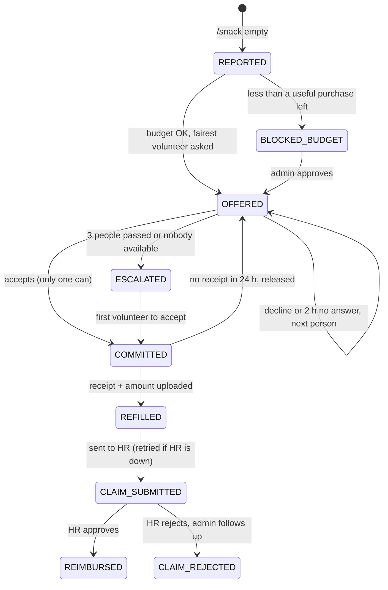

# Snack Counter Automation: Design

## What "automate" means here

Buying snacks stays a human job. What breaks today is the **coordination around it**, so that is what gets automated. A chat bot, backed by a small Node.js service:

- turns "the box is empty" into a refill with exactly **one named owner**,
- chooses that owner fairly,
- states the spending limit up front,
- hands the refill on when the owner stalls,
- files the HR claim the moment the receipt is uploaded,
- follows the claim until it is paid,
- produces one monthly report across both currencies.

## How a refill moves from "empty" to "reimbursed"

Every legal move is listed in one table in code. Anything else throws, and every move is appended to an audit history. Deadlines are stored on the refill, not held in in-memory timers. A scheduler job that runs every few minutes does three things: expires offers and commitments, retries HR, and polls claim status. That makes a restart, a missed run or a doubled run harmless.

## Main parts and the data each keeps

| Part | Job | Data it keeps |
|---|---|---|
| **Refill state machine** (pure) | Legal transitions, versioning, audit trail | `Refill`: office, state, version, assignee, people already asked, cap, deadlines, purchase, claim, history |
| **Assignment policy** (pure function) | Who buys next | None. Reads volunteers and refill history |
| **Budget rules** (pure) | Remaining budget, cap, monthly spend | None. Derived from purchases, so no second copy can drift |
| **Refill service** | Report, offer, accept, decline, timeouts, receipt, admin actions | Writes refills through the store |
| **Claims service** | Submit with idempotency key, retry, poll, nudge | `claim` on the refill: HR id, attempts, last error, dates |
| **Volunteer service** | Holidays and cross-office visits | `Volunteer`: home office, active, away periods, visits |
| **Report service** | Monthly report and chat delivery | Exchange rates used are stored in the report |
| **Ports + fakes** | Chat, HR, clock, store are injected | Fakes record messages and claims for tests |
| **Config** | Offices (currency, timezone, budget, typical range, admin) and timing rules | Static |

## How each problem is prevented

| Problem | Prevention |
|---|---|
| **Box empty for days** | One named person is asked, not a group: group requests cause the "someone else will do it" effect. A 2 h offer timeout and a 24 h purchase deadline pass the refill on automatically. After 3 people pass, it opens to everyone and the admin is pinged. The report shows average hours empty |
| **Two people buy the same day** | At most **one open refill per office**, and repeat reports join it. Accepting is a compare-and-set on the refill's `version`, so exactly one accept wins. The channel is told "X is refilling, nobody else needs to buy". A released buyer is told explicitly not to buy |
| **Same few people, slow money** | Ranking puts first whoever has (1) no claim still awaiting reimbursement, then (2) the fewest refills in the last 90 days, then (3) the longest gap since their last refill. Claims are filed automatically on receipt upload, retried until accepted, and the admin is nudged after 10 days |
| **Unknown spend / what's eaten** | Every purchase is recorded with office, currency and office-local month. The monthly report gives native totals, budget used %, one combined total with the exchange rate stored, refills per person, and the "ran out first" items |

**Money and currencies.** Amounts are integer minor units (øre, paise). Mixing currencies throws. A budget belongs to the **counter**, in its currency. A Bengaluru employee refilling the Oslo box spends Oslo's NOK budget, and the claim is filed in NOK; HR pays them in their INR payroll, as the brief says. A purchase belongs to the month it was made in, in the office's timezone, not when HR approved it.

## Trade-offs

- **Direct assignment over "first come first served".** It is a little slower but removes the bystander effect. Broadcast is kept as the fallback.
- **Working from home is not tracked.** Daily check-ins would not happen. A one-tap Decline moves the refill on instantly. Only holidays and visits are declared.
- **Soft cap.** An overspend within 10% is fine. Above that it is flagged but still reimbursed, because the volunteer has already paid. Running out of budget blocks *before* anyone buys, never after.
- **No reservation ledger.** With one open refill per office, the cap told to the buyer *is* the reservation.
- **Polling HR, not webhooks.** It works whatever the vendor supports. The idempotency key means a retry never creates a second claim.
- **Wall-clock timeouts.** An offer can expire overnight. An office working-hours calendar is the first follow-up.
- **In-memory store behind a store interface.** Each method maps to one SQL statement, including `UPDATE … WHERE version = $n` and a partial unique index for "one open refill per office".

## Deliberately not built

Sensors or cameras on the box. Receipt OCR. Company cards or direct procurement (worth proposing, but it changes the process instead of automating it). Our own payroll exchange-rate conversion (HR owns it). Snack voting and per-item inventory. A web dashboard: the bot and a monthly chat report are enough at 35 users. Real Slack/Teams and HR clients: both are fakes behind the same interfaces.

## Assumptions (questions I would ask first)

- Management's reporting currency and the exchange-rate source. The code takes both as parameters and stores the rates used.
- Does the HR API support idempotency keys or webhooks? The code assumes idempotency keys. If they are not supported, the adapter would first look up an existing claim by the refill id before retrying.
- Who approves going over budget? A configurable admin per office is assumed.
- Is "month" the calendar month in each office's local time? Assumed yes.
