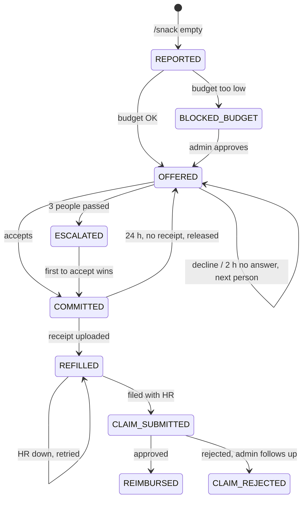

# Snack Counter Automation: Design

## Approach

Buying snacks stays a human job. What breaks is the coordination around it, so that is what gets automated. A chat bot, backed by a small Node.js service, gives each empty box **one named owner**, chosen fairly, and tells them their spending limit. It hands the refill on if they stall, files the HR claim as soon as the receipt is uploaded, and follows the claim until it is paid. It also sends one monthly report across both currencies.

## How a refill moves from "empty" to "reimbursed"

**Timers:**
- A volunteer has 2 h to answer an offer and 24 h to upload a receipt.
- After 3 people pass, the refill opens to everyone and the admin is pinged.
- A claim still pending after 10 days triggers a nudge.

**Reliability:**
- Deadlines are stored on the refill, and a scheduler job checks them every few minutes, so a restart or a missed run loses nothing.
- All legal moves sit in one table in the code. Anything else throws.
- Every move is written to an audit history.

## Main parts and their data

| Part | Job | Data it keeps |
|---|---|---|
| **Refill state machine** | Legal moves, version number, audit history | Refill: office, state, version, current assignee, people already asked, cap, deadlines, purchase, claim, history |
| **Assignment policy** | Picks who buys next (pure function) | Nothing. It reads volunteers and past refills |
| **Budget rules** | Remaining budget, cap, monthly spend | Nothing. It always derives from purchases, so it cannot drift |
| **Refill service** | Report, offer, accept, decline, timeouts, receipt, admin actions | Writes refills through the store |
| **Claims service** | Files the HR claim, retries, polls status, nudges | HR claim id, attempts, last error, dates |
| **Volunteer and report services** | Holidays and visits; monthly report | Volunteer: home office, holidays, visits. Report: the exchange rates used |
| **Adapters** | Chat, HR, storage and clock, injected (fakes in tests) | The store checks the version on every write |

## How each problem is prevented

| Problem | Prevention |
|---|---|
| **Box empty for days** | One named person is asked, not a group. Unanswered or unfinished refills move on automatically. After 3 people, everyone is asked and the admin is pinged |
| **Two people buy the same day** | Only one open refill per office, and repeat reports join it. Accepting checks the refill's version, so exactly one accept wins. The channel hears "X is refilling", and a released buyer is told not to buy |
| **Same few people, slow money** | The rotation picks: 1. people not waiting for a reimbursement first, 2. then whoever has the fewest refills in 90 days, 3. then whoever refilled least recently. Claims are filed on receipt upload, then retried, tracked and chased |
| **Unknown spend** | Every purchase is recorded by office, currency and local month. The report gives per-office totals, budget used, one combined total with the exchange rates stored, refills per person and what ran out first |

**Money:**
- Amounts are whole øre and paise. Mixing currencies throws an error.
- Budgets belong to the counter, not the person. A Bengaluru visitor refilling Oslo spends Oslo's NOK budget and files the claim in NOK, and HR pays them in INR.
- A purchase counts in the month it was made, in that office's timezone.

## Trade-offs

- **One named person, not "first come, first served".** It is slightly slower, but it removes the "someone else will do it" effect. Broadcasting is the fallback.
- **No work-from-home tracking.** Daily check-ins would not happen, and Decline is one tap.
- **Soft spending cap.** Up to 10% over is fine. More is flagged but never refused, because the volunteer has already paid. A low budget blocks the refill *before* anyone buys.
- **Polling HR with an idempotency key.** This works whatever the vendor offers, and a retry never creates a second claim.
- **Clock-hour timeouts.** An offer can expire overnight. Office working hours are the first follow-up.
- **In-memory store behind an interface.** Each method maps to one SQL statement.

## Out of scope

**The rule:** build only what fixes one of the four problems, or makes that fix reliable. At 35 volunteers, anything else costs more than it returns.

| Left out | Why |
|---|---|
| **Sensors or cameras** | Someone still has to refill the box. A one-tap report is enough |
| **Receipt OCR** | Typing one amount is quicker than checking OCR output, and HR reviews the receipt anyway |
| **Company card** | It would remove reimbursement, but it is a finance decision, not automation. Worth proposing |
| **Payroll currency conversion** | HR already pays in payroll currency. Doing it twice risks mismatches |
| **Second approval step** | HR approves claims. Another step slows reimbursement |
| **Voting, stock tracking** | Fixes none of the four problems. "What ran out first" already shows what gets eaten |
| **Web dashboard** | Everyone is in chat, and the report is one message |
| **Real chat/HR clients, database** | The brief asks for stand-ins. Real ones plug into the same interfaces |

## Assumptions to confirm

- **Reporting currency and exchange-rate source:** passed in as parameters. The rates used are stored with each report.
- **HR API:** it supports idempotency keys, and claim status is polled.
- **Over-budget approval:** one admin per office approves going over budget.
- **"Month":** the calendar month in each office's local time.
