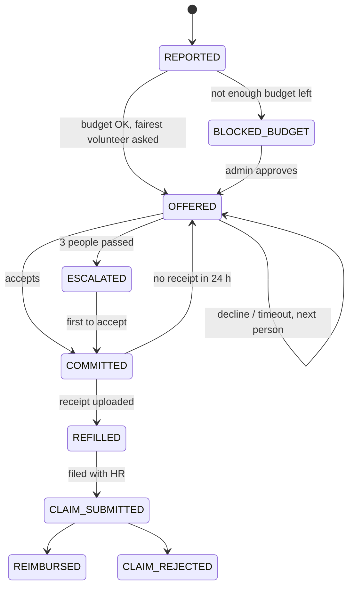

# Snack Counter Automation

A small Node.js service that coordinates snack counter refills for two offices (Oslo, NOK and Bengaluru, INR): **who buys**, **how much they may spend**, **getting them reimbursed**, and **one monthly report** across both currencies.

The chat tool and the HR system are simulated, so everything runs locally with **zero dependencies**.

## The problem

| Today | With this service |
|---|---|
| The box sits empty for days because everyone assumes someone else will refill it | One **named** volunteer is asked. No answer in 2 h or no receipt in 24 h moves it to the next person. After 3 people, it opens to everyone and the admin is pinged |
| Two people buy on the same day | At most **one open refill per office**. Exactly one person can accept (compare-and-set). The channel is told "X is refilling" |
| A few people do most refills and wait weeks for money | Fair rotation: people still awaiting reimbursement go last, then fewest refills in 90 days. HR claims are filed automatically on receipt upload, retried, tracked and chased |
| Nobody knows the monthly spend | Purchase ledger plus a monthly report: per office in its currency, combined in one reporting currency, with the exchange rates stored |

## Quick start

Requires Node.js 20 or later.

```bash
npm test          # 52 tests, about 150 ms
npm run demo      # narrated walk through one week, printing every chat message
```

There is nothing to install: no `npm install` is needed.

## Example (from `npm run demo`)

```
Ola reports the Oslo box empty (chips ran out first)
    [chat -> anna] Hi Anna, the Oslo snack box is empty and you're up next (R-1). Budget: up to 1200.00 NOK. ...
Anna has not answered. 2.5 hours later the scheduler runs
    [chat -> bjorn] Hi Bjørn, the Oslo snack box is empty and you're up next (R-1). ...
Bjørn is working from home today and taps Decline
    [chat -> kari] Hi Kari, ...
Kari accepts
    [chat -> #snacks-OSL] Kari is refilling the Oslo box. Nobody else needs to buy.
...
Total across offices: 1238.00 NOK
```

## Refill lifecycle



## Project layout

```
src/
  config.js                  offices, budgets, timing rules
  domain/                    pure business rules, no I/O
    refill.js                state machine: legal transitions, version, audit history
    assignmentPolicy.js      who buys next (fair, deterministic)
    budget.js                remaining budget, spending cap, monthly spend
    money.js                 integer minor units, refuses to mix currencies
    time.js                  office-timezone dates and months
    errors.js                named domain errors
  services/                  use cases
    refillService.js         report, offer, accept, decline, timeouts, receipt, admin
    claimsService.js         HR submission (idempotent), retry, status polling, nudges
    volunteerService.js      holidays and cross-office visits
    reportService.js         monthly report
  adapters/                  swappable plugs for the outside world
    inMemoryStore.js         storage with optimistic locking
    fakeChat.js  fakeHr.js   simulated chat tool and HR system
    clock.js                 real clock and test clock
  ports.js                   contracts for chat, HR, clock
  app.js                     wiring + scheduled jobs
test/                        one file per rule area
demo.js                      narrated scenario
```

## Using it from code

```js
import { createApp } from './src/app.js';
import { Money } from './src/domain/money.js';

const app = createApp({ store, chat, hr, clock }); // pass real or fake adapters

const refill = await app.refills.reportEmpty('OSL', 'ola', { ranOut: ['chips'] });
await app.refills.acceptRefill(refill.id, refill.assigneeId);
await app.refills.completeRefill(refill.id, refill.assigneeId, {
  amount: Money.of(950, 'NOK'),
  receiptImage: 'receipt.jpg',
});

await app.runScheduledJobs(); // cron every ~5 min: timeouts, HR retries, claim status
app.reports.monthlyReport('2026-11', { reportingCurrency: 'NOK', fxRates: { INR: 0.12 } });
```

## Design decisions in brief

- **Ports and adapters.** The domain is pure. Chat, HR, storage and clock are injected, so Slack, the real HR API or Postgres can replace the fakes without touching the rules.
- **Explicit state machine.** One table lists every legal move. Anything else throws. Every move is recorded.
- **Deadlines are data, not timers.** A scheduler job compares them with the clock, so restarts and late or doubled runs are harmless.
- **Optimistic locking.** Each write checks the version it read. That maps directly to `UPDATE … WHERE version = $n` in SQL.
- **Budgets belong to the counter.** A visitor buying in Oslo spends Oslo's NOK budget. The claim is filed in NOK, and HR pays them in their payroll currency.
- **Months are office-local.** 00:30 on 1 Dec in Bengaluru counts in December.

## Documentation

| Document | For |
|---|---|
| [`DESIGN.md`](DESIGN.md) | The 2-page design (submission) |
| [`docs/DESIGN-DETAILED.md`](docs/DESIGN-DETAILED.md) | Functional and non-functional requirements, trade-offs, out of scope, scaling path |
| [`docs/CODE-WALKTHROUGH.md`](docs/CODE-WALKTHROUGH.md) | File-by-file, line-referenced explanation, likely questions, presentation script |

## Out of scope

Only what fixes one of the four problems, or makes that fix reliable, was built. At 35 volunteers, everything else costs more than it returns.

- **Box sensors or cameras.** Someone still has to refill it. A one-tap chat report detects "empty" well enough.
- **Receipt OCR.** Typing one amount is quicker than checking OCR output, and HR reviews the receipt anyway.
- **Company card or procurement.** It changes the process (a finance decision) instead of automating it. Worth proposing separately.
- **Payroll currency conversion.** HR pays in payroll currency. Converting ourselves would duplicate that and risk mismatches.
- **A second approval workflow.** HR already approves claims. Another step would slow reimbursement.
- **Snack voting or stock tracking.** It doesn't fix any of the four problems. The "ran out first" items already show what gets eaten.
- **A web dashboard.** Everyone is in chat, and the monthly report is one message.
- **Real chat/HR clients and a database.** The brief asks for simulated stand-ins. They plug in behind the same interfaces later.

Full reasoning: [`DESIGN.md`](DESIGN.md#out-of-scope).
