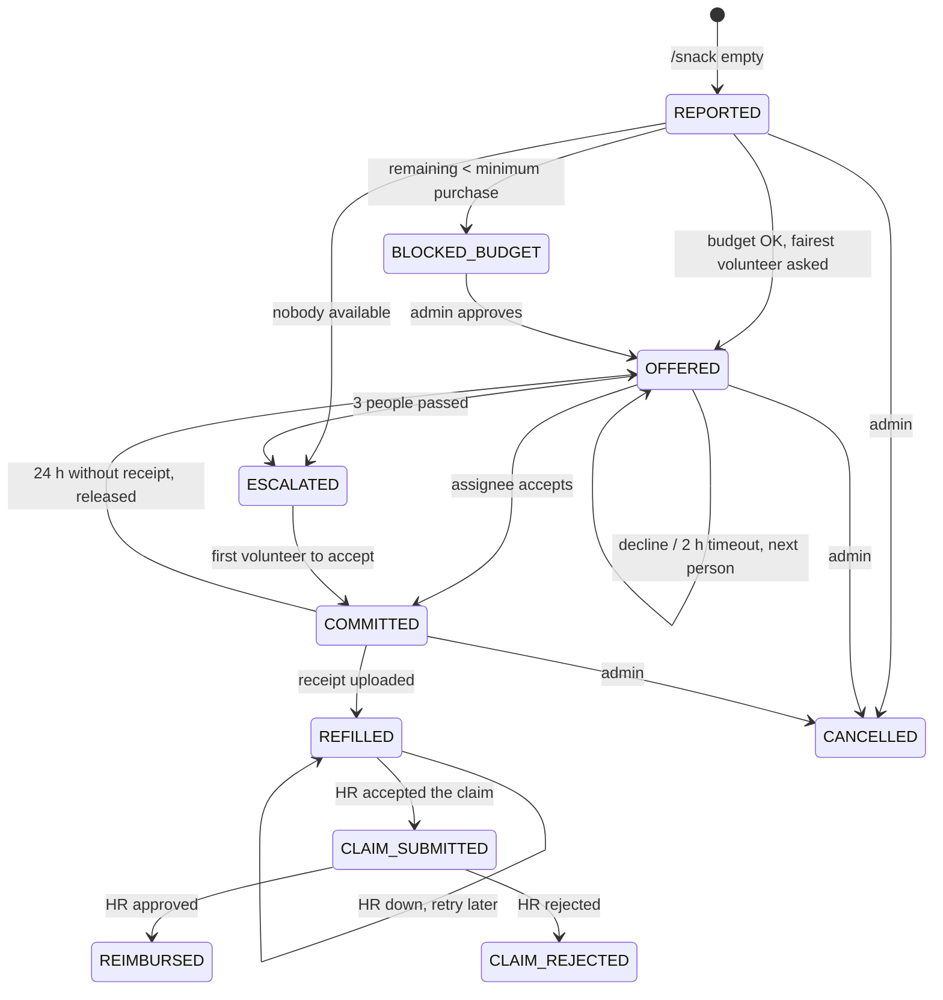

# Snack Counter Automation: Detailed Design

> The 2-page submission version is [`../DESIGN.md`](../DESIGN.md). This document adds the full requirements, the reasoning behind each decision, how the design scales, and how each test maps to a rule.

**Runtime:** Node.js ≥ 20, plain JavaScript (ES modules), zero runtime dependencies, tests with the built-in `node:test`.

---

## 1. Problem summary

Two offices (Oslo ~15 volunteers, Bengaluru ~20 volunteers) each run a snack counter. A volunteer buys snacks with their own money, refills the box and files a reimbursement claim in an external HR system. The informal process fails in four ways:

| # | Symptom | Root cause |
|---|---------|------------|
| P1 | Box sits empty for days | Bystander effect: nobody owns the refill |
| P2 | Two people buy on the same day | No shared, authoritative "someone is on it" signal |
| P3 | Same few people refill, then wait weeks for money | No fair rotation; claims filed late and not followed up |
| P4 | Nobody knows monthly spend or what gets eaten | No ledger, two currencies, no reporting |

**What "automate" means here:** the physical buying cannot be automated, so the **coordination** is: who is responsible right now, how much they may spend, that the claim is filed and chased, and that everything is recorded.

## 2. Core functionalities

| # | Feature | Where in code |
|---|---------|---------------|
| 1 | **Report empty.** One open refill per office. Repeat reports join it and add "what ran out" | `RefillService.reportEmpty` |
| 2 | **Budget check.** Remaining budget, then the cap told to the buyer, or blocked with admin approval | `domain/budget.js`, `#offerToNextVolunteer` |
| 3 | **Choose who buys.** Fair, deterministic ranking of who is physically at the office | `domain/assignmentPolicy.js` |
| 4 | **Commit.** Exactly one person can accept | `RefillService.acceptRefill` + `InMemoryStore.saveRefill` |
| 5 | **Handover.** Decline, offer timeout or purchase timeout moves to the next person, then escalates | `declineRefill`, `checkTimeouts` |
| 6 | **Receipt.** Validates currency and receipt, flags overspend, closes the refill | `completeRefill` |
| 7 | **HR claim.** Auto-submitted, idempotent, retried, polled, nudged | `ClaimsService` |
| 8 | **Availability.** Holidays and cross-office visits | `VolunteerService` |
| 9 | **Monthly report.** Per office native, combined in a reporting currency, rates stored | `ReportService` |
| 10 | **Admin actions.** Approve going over budget, cancel a false alarm | `approveOverBudget`, `cancelRefill` |

## 3. Refill lifecycle



| Timer (in `src/config.js`) | Default | On expiry |
|---|---|---|
| `offerTimeoutHours` | 2 | Offer passes to the next person, who is told "nothing to do" |
| `purchaseTimeoutHours` | 24 | Buyer is released ("please do NOT buy"), next person asked |
| `maxDirectOffers` | 3 | Opened to everyone in the channel, admin pinged |
| `claimNudgeAfterDays` | 10 | Admin nudged once to chase HR |
| `hrMaxAttempts` | 5 | Auto-retry stops, admin asked to file by hand |

## 4. Choosing who buys

**Eligible** volunteers must be all of these:
- active,
- physically at this office today: home office, or a declared visit,
- not on a declared holiday,
- not already asked for this refill,
- not currently asked or buying for another open refill.

**Ranking** (fairest first):
1. fewest refills still awaiting reimbursement: nobody fronts money twice while someone else hasn't once,
2. fewest refills in the last 90 days: spreads the load,
3. longest since their last refill,
4. employee id: deterministic, so tests and explanations are reproducible.

**Why not track working from home?** Nobody will check in daily. A one-tap Decline costs less and moves the refill on immediately.

## 5. Budget and money

- **Budgets belong to the counter, not the person.** A Bengaluru visitor buying in Oslo spends Oslo's NOK budget. The claim goes to HR in NOK (the receipt currency), and HR converts to the visitor's INR payroll. We never do payroll conversion.
- **Remaining** = `monthlyBudget − spend this month`. Spend counts claims in `REFILLED`, `CLAIM_SUBMITTED` and `REIMBURSED`. A rejected claim is not company spend.
- **Cap** = `min(typical max, remaining)`. If `remaining < typical min`, the refill goes to `BLOCKED_BUDGET` and the admin decides.
- **No reservation ledger:** with only one open refill per office, the cap *is* the reservation.
- **Overspend:** up to 10% over the cap is accepted silently. Above that it is flagged to the admin, but the claim is still filed.
- **Representation:** `Money` holds integer minor units plus a currency code, and is immutable. Mixed-currency arithmetic throws.
- **Month attribution:** by purchase time in the office's timezone. 00:30 on 1 Dec in Bengaluru is December, even though it is 30 Nov in UTC.
- **Reporting currency:** converted only in the report, once per office total, with the rates stored in the report.

## 6. Components and data

```
            chat tool (Slack/Teams)                         HR vendor API
                   │  ChatPort                                   │  HrPort
┌──────────────────▼─────────────────────────────────────────────▼──────────┐
│ services/   RefillService ───────────► ClaimsService                      │
│             VolunteerService             ReportService                    │
│                   │ uses                                                  │
│ domain/     refill.js (state machine)  assignmentPolicy.js  budget.js     │
│             money.js   time.js   errors.js        (pure, no I/O)          │
└──────────────────┬────────────────────────────────────────────────────────┘
                   │  store (InMemoryStore now, Postgres later), Clock
```

| Entity | Fields |
|---|---|
| `Office` (config) | id, name, currency, timeZone, monthlyBudget, minPurchase, maxPurchase, adminId |
| `Volunteer` | id, name, homeOfficeId, active, away[{from,to}], visits[{officeId,from,to}] |
| `Refill` | id, officeId, state, version, reportedAt, reportedBy[], ranOut[], assigneeId, triedIds[], cap, offerExpiresAt, purchaseDueAt, budgetOverride, purchase{buyerId, amount, receiptImage, items, purchasedAt, overCap}, claim{hrClaimId, attempts, lastError, submittedAt, decidedAt, nudgedAt}, history[] |
| `Report` (output) | month, reportingCurrency, fxRates, per-office figures, total |

## 7. How each problem is prevented

| Problem | Mechanism |
|---|---|
| P1 Empty for days | One named owner. Each waiting state has a deadline. Automatic handover, then broadcast and an admin ping. Average hours empty is reported |
| P2 Two buyers | One open refill per office. Repeat reports merge. Compare-and-set accept. Channel announces the buyer. A released buyer is told not to buy and can no longer complete |
| P3 Unfair load / slow money | Unpaid-first, then 90-day fairness ranking. Claim auto-filed on upload, retried, polled, nudged |
| P4 No visibility | Purchase ledger by office-local month. Monthly report with native totals, combined total, stored rates, refills per person, "ran out first" |

## 8. Functional requirements

| ID | Requirement | Test |
|----|-------------|------|
| FR-1 | Anyone can report an office's box empty. Repeat reports while a refill is open are merged | `lifecycle.test.js` |
| FR-2 | Exactly one eligible volunteer is offered each refill, chosen by the fairness policy | `assignment.test.js` |
| FR-3 | Only the current assignee can accept an offer. On an escalated refill, the first accept wins and all others are refused | `commit.test.js` |
| FR-4 | Unanswered offers and uncompleted commitments are handed over after their timeout. Nobody is asked twice | `handover.test.js` |
| FR-5 | After `maxDirectOffers`, or when nobody is available, the refill escalates to the channel and the admin | `handover.test.js` |
| FR-6 | Eligibility follows physical location (visits) and holidays | `assignment.test.js`, `handover.test.js` |
| FR-7 | A budget check runs before every offer. The cap is communicated. Not enough budget blocks until admin approval | `budget.test.js` |
| FR-8 | The receipt must be in the counter's currency, with an image. Overspend is flagged, not blocked | `budget.test.js` |
| FR-9 | The HR claim is created automatically, idempotently, and retried while HR is down | `claims.test.js` |
| FR-10 | Claim status is tracked to reimbursed or rejected, people are notified, and slow claims are nudged | `claims.test.js` |
| FR-11 | Monthly report: per-office native spend and budget %, a combined total in a reporting currency with stored rates, refills per person, ran-out items | `report.test.js` |
| FR-12 | Every state change is recorded in the refill's history | `lifecycle.test.js` |

## 9. Non-functional requirements

| Area | Requirement and how it is met |
|---|---|
| **Correctness** | Integer money. Explicit state-transition table. Immutable refill updates |
| **Concurrency** | Read-check-write without `await` in between (atomic in Node's single thread), plus a version compare-and-set in the store for multi-server deployments |
| **Idempotency** | HR idempotency key = refill id. Scheduler jobs are safe to run twice or late |
| **Reliability** | HR outages never block a refill: the claim is queued in `REFILLED` and retried. Deadlines are stored data, so a restart loses nothing |
| **Time** | All day and month logic uses the office's IANA timezone (`Europe/Oslo`, `Asia/Kolkata`) |
| **Testability** | Pure domain. Chat, HR, store and clock are injected. A fake clock "fast-forwards" hours in 0 ms. 52 tests run in ~150 ms |
| **Auditability** | `history[]` on each refill answers "who was asked, when, and what happened" |
| **Security / privacy** | Identity comes from company SSO via the chat tool. Admin-only actions are checked. Receipts only go to HR |
| **Scale** | ~35 users and a few refills a week, so one small service plus one database is enough |
| **Usability** | Everything is one or two taps in chat. No new app or login |

## 10. Trade-offs

| Decision | Chosen | Alternative | Why |
|---|---|---|---|
| Who buys | Direct, one person | Broadcast, first come | Broadcast recreates the bystander effect. It is kept as the fallback |
| WFH tracking | Not tracked, Decline instead | Daily check-in | Check-ins would not happen. A decline is one tap |
| Overspend | Soft cap + flag | Block reimbursement | The volunteer has already paid |
| Budget reservation | Cap = reservation | Reservation ledger | One open refill per office makes a ledger redundant |
| Claim currency | Receipt currency | Convert to payroll | HR owns payroll currency conversion |
| Month | Purchase date, office timezone | HR approval date | Approval lags by up to 10 days |
| HR status | Polling | Webhooks | Works with whatever the vendor offers |
| Timeouts | Wall-clock hours | Working-hours calendar | Simpler. The calendar is the first follow-up |
| Retry | Every scheduler run, max 5 | Exponential backoff | Enough at this volume. Backoff is a small change (`nextAttemptAt`) |
| Persistence | In-memory behind a store interface | Database now | Keeps the exercise focused. Every method maps to one SQL statement |

## 11. Out of scope (deliberately)

- Sensors, scales or cameras to detect an empty box.
- Receipt OCR or line-item extraction.
- Company card or direct procurement. A strong proposal, but it changes the process instead of automating it.
- Payroll currency conversion and payout (HR).
- Approval workflows duplicating HR's.
- Snack voting, nutrition preferences, per-item inventory.
- Web dashboard or mobile app.
- Real Slack/Teams and HR clients (fakes implement the same ports), and a real database.

## 12. Scaling and extending later

| Need | Change |
|---|---|
| Real chat | A `SlackChat` adapter implementing `sendDirect` / `postToChannel`. Slash commands and buttons call the same service methods |
| Real HR | An `HrClient` adapter that formats `Money` as amount + currency and uploads the image |
| Database | `PostgresStore` with `UPDATE … WHERE id=$1 AND version=$2` and `CREATE UNIQUE INDEX … ON refills(office_id) WHERE state IN (open states)` |
| Several servers | Already safe thanks to the version check. Run the scheduler on one instance, or behind a DB advisory lock |
| More offices | Add an entry in `OFFICES`. No code change |
| Working hours | `rules.workingHours` per office, and compute deadlines with a business-hours `addHours` |
| Smarter fairness | Swap `rankCandidates`. It is a pure function with its own tests |

## 13. Open questions

| Question | Assumption |
|---|---|
| Reporting currency and exchange-rate source? | Parameter. Rates passed in and stored with the report |
| Calendar month in local time? | Yes |
| HR idempotency keys / webhooks? | Idempotency keys assumed. Polling |
| Presence data (badge, calendar)? | Not available. Holidays and visits are self-declared |
| Who can approve going over budget? | One admin per office |
| Proactive weekly refills instead of reactive? | Reactive |

## 14. References

- Rotation bots (one named owner, hand-over): [Rota slackbot](https://dev.to/kimmaida/hello-rota-a-slackbot-for-rotation-management-216c), [dienstplan](https://github.com/pilosus/dienstplan), [Sparkbox lunch-bot](https://sparkbox.com/foundry/introducing_lunch_bot_a_slack_integration_to_help_us_eat)
- Fair assignment: [Guide least-recently-assigned](https://support.guide.co/en/articles/15472823-round-robin-auto-assignment-for-scheduling-queues), [Atlassian: fair is not always equal](https://community.atlassian.com/forums/App-Central-articles/Fair-Assignment-Is-Not-Always-Equal-Assignment/ba-p/3254412)
- Money: [Clara: type-safe money](https://engineering.clara.com/blog/type-safe-money), [Vendure money docs](https://docs.vendure.io/current/core/core-concepts/money.md), [Multi-currency storage](https://subtracker.io/build/multi-currency-money-storage)
